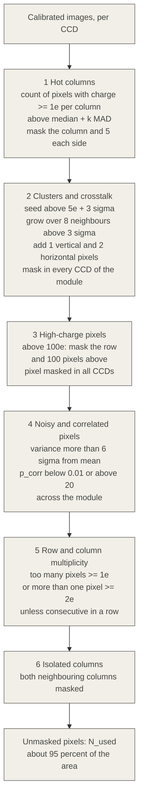
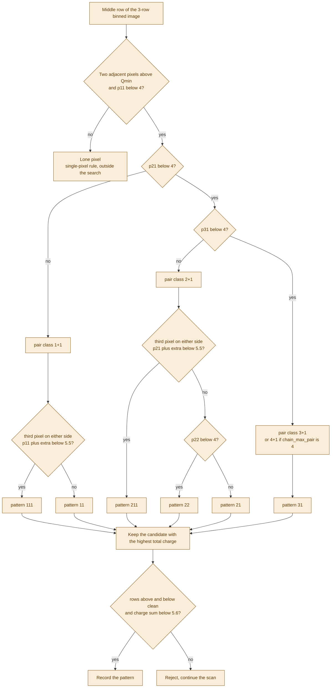
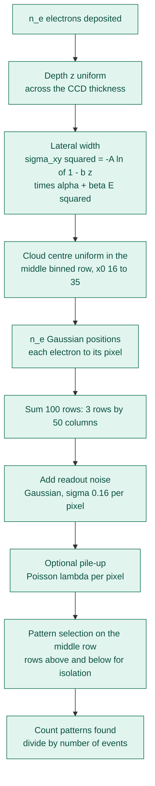
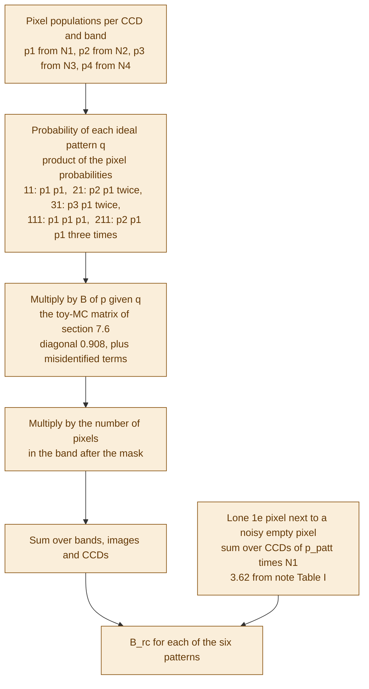
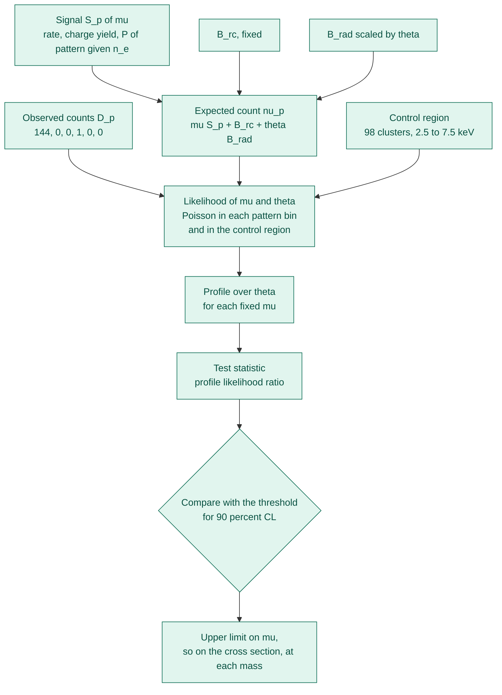
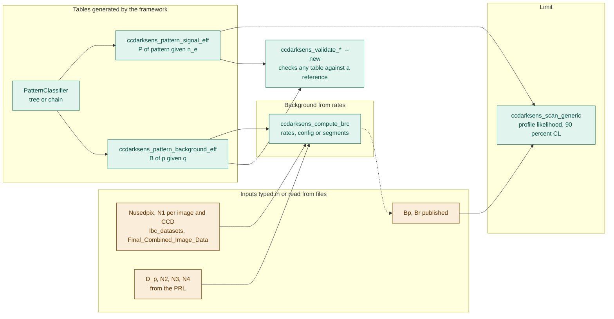

<!--
Diego Venegas-Vargas
DAMIC-M collaboration
CCDarkSens Framework

Pipeline_Raw_Data_to_Limit.md -- The DAMIC-M pattern analysis from raw CCD images to the exclusion limit, with its counterpart in the framework, what is reproduced and what is not.
-->

# From Raw CCD Images to an Exclusion Limit

**The DAMIC-M pattern analysis, stage by stage, and what CCDarkSens does with each stage**

This document follows one dataset all the way through the analysis: raw skipper-CCD images, calibration, masking, pattern selection, the efficiency tables, the two backgrounds, the signal prediction, the likelihood and the 90% CL limit. For every stage I state what the collaboration does, what the framework contains, how well the framework reproduces the published numbers, and where the evidence comes from. It is also the reference for adding a new pattern bin to the analysis, which is the reason I wrote it (§15).

---

## 0. How to read this document

### 0.1 Sources and evidence tags

Every statement carries the source it rests on.

| Tag | Source |
|---|---|
| **[PRL]** | K. Aggarwal et al. (DAMIC-M), *Probing Benchmark Models of Hidden-Sector Dark Matter with DAMIC-M*, Phys. Rev. Lett. 135, 071002 (2025), arXiv:2503.14617. Main text and End Matter. |
| **[note]** | P. Privitera, *Data Selection for 2024 Science Run*, internal note, 3 February 2025. It optimises the selection on 7.7 days of unblinded data and defines the pattern-identification variables. This is the only description of the selection code that is available; there is no source code. |
| **[SRDM]** | *Constraints on Sub-MeV Dark Matter from Solar Reflection with DAMIC-M*, arXiv:2607.09352. Same data set, same backgrounds, a different signal. Its Eqs. (4)–(7) give the background construction in the most explicit form. |
| **[pydme]** | The collaboration Python code and notebooks in `collab_frameworks/` (`efficiencies.py`, `pydme/`, `How_to_calculate_efficiencies_for_patterns.ipynb`, `DataSimulator.ipynb`). |
| **[files]** | Numbers read directly from the data files in `data/` and `collab_frameworks/pydme/pydme/data/lbc_datasets/`. |
| **[measured]** | A result I computed with the framework for this document. |
| **[inferred]** | A conclusion I drew that no source states. These are the statements to be most careful with. |

### 0.2 Status labels

| Label | Meaning |
|---|---|
| **Reproduced** | The framework produces the published or reference number within statistics. |
| **Partial** | The framework produces it, but only approximately, or only for part of the quantity. |
| **Not in framework** | The framework has no code for it; the number is typed in as an input. |
| **Not audited** | The code exists and was verified earlier against a reference application, but I did not re-examine it for this document. |

### 0.3 Summary of where things stand

| Quantity | Published | Framework | Status |
|---|---|---|---|
| Observed candidates D_p = (144, 0, 0, 1, 0, 0) | PRL | typed-in input | Not in framework |
| Mask retention ≈ 95% | PRL Table II | `Nusedpix` read from data | Not in framework |
| Isolated 2e⁻ / 3e⁻ / 4e⁻ pixels = 184 / 17 / 1 | PRL | typed-in input | Not in framework |
| Single-e⁻ rate 2.4–3.1 ×10⁻⁴ | PRL | from the `lbc_datasets` files | Reproduced (arithmetic on data files) |
| Pattern efficiency of a (2, 3, 4, 5) e⁻ deposit = (38, 65, 79, 86)% | PRL | `chain` selection: (38.7, 65.5, 79.3, 86.3)%; default `tree`: (37.5, 63.9, 74.7, 24.7)% | Reproduced with `chain` (entry by entry at n_e = 2–4; n_e = 5 differs in single entries); not with the default table |
| Pair identification efficiency ≈ 0.908 | note | 0.9084 (`chain`) | Reproduced |
| Lone-pixel accidental {11} ≈ 3.7 | PRL | 3.62 from the note's Table I; the matrix gives 2–3× too much if both pixel orientations are counted | Partial |
| B^rc = (141.4, 0.111, 0.042, 0.019, 2.5×10⁻⁵, 5.8×10⁻⁵) | PRL | formula exact; {11} matches with one fitted parameter; {111} about +10%, {31} about −28% | Partial |
| B^rad = (0.039, 0.039, 0.016, 0.052, 0.011, 0.035) | PRL | typed-in input | Not in framework |
| Profile likelihood, Gamma prior of strength 98, 90% CL limit | PRL, note | `ccdarksens_scan_generic` | Not audited here (verified bit-exact against the reference scan app earlier) |

The rest of the document justifies each line.

---

## 1. The experiment and the observable

### 1.1 Detector and data taking [PRL]

- The data come from the DAMIC-M Low Background Chamber (LBC), a prototype at the Modane Underground Laboratory. It hosts two prototype modules, each with four high-resistivity (> 10 kΩ cm) n-type silicon **skipper CCDs**.
- Each CCD has an active area of **6144 × 1536 pixels**, a pixel size of **15 × 15 µm²**, a thickness of **670 µm** and a mass of about 3.3 g. The CCDs run at about 130 K, fully depleted at a substrate bias of **45 V**.
- Skipper amplifiers measure the same charge packet many times non-destructively. The resulting pixel-charge resolution is **σ_ch ≈ 0.16 e⁻**, which is what allows individual electrons to be counted.
- The readout uses **100 × 1 binning**: 100 physical rows are summed into one recorded pixel. "Pixel" always means a binned pixel below. A 6144 × 1536 CCD becomes 6144 columns by about 16 binned rows, so a CCD-image has **98 304 binned pixels** [measured: 16 × 6144, consistent with the `Nusedpix` maxima].
- Images are read out without dead time, so the exposure of each pixel is about the image readout time, **1668 s** [PRL]. [files] README: exposure per binned pixel = 1659.405 s; mass of one binned pixel = 100 × 2.33 g cm⁻³ × 0.0015 cm × 0.0015 cm × 0.0669 cm = 3.5072 ×10⁻⁵ g.
- Data taking: about 84 days, October 2024 to January 2025.
- Two of the eight CCDs (in module 2) are excluded because of readout anomalies, leaving **six CCDs** [PRL]. [files] The six are module-103 CCDs A, B, C, D (3984 images each) and module-104 CCDs B (1506 images) and D (2891 images), 20 333 CCD-images in total. The image-ID ranges listed in the note (§V.A) give 3984 images for each module-103 CCD, exactly the files, and 1513 and 2898 for module-104 CCDs B and D, 7 images more than the files (1506 and 2891); the extra 7 images are also present as failed rows in the fit-parameter files (§3.3).

### 1.2 Why patterns [PRL]

An ionisation event produced in the bulk of the silicon drifts to the pixel array and **diffuses laterally**. The lateral width σ_xy depends on the interaction depth z. With 100 × 1 vertical binning only the horizontal spread matters, so a deposit of a few electrons appears as a short horizontal cluster of 1, 2 or 3 charged pixels. The charges in the cluster, written as digits, label the **pattern**: {21} is a 2e⁻ pixel next to a 1e⁻ pixel, {111} is three adjacent 1e⁻ pixels.

Single dark-current electrons appear as isolated 1e⁻ pixels. Two difficulties make a search based on isolated pixels unattractive:

1. In D1 and D2 the isolated **2e⁻ and 3e⁻ populations are not Poissonian** given the isolated 1e⁻ rate. D2 has 184 isolated 2e⁻ pixels against 70.2 expected, 17 isolated 3e⁻ pixels against 7×10⁻³ expected, and 1 isolated 4e⁻ pixel against 3×10⁻⁷ [PRL]. The origin is under study; the excess is much larger in one CCD, which suggests charge released in the serial register or the readout stage.
2. A DM search on isolated pixels would therefore be limited by a background that has no model.

The analysis therefore **excludes single-pixel clusters** and searches for patterns of two or three adjacent pixels. The accidental background of such patterns, the *random coincidence* of single-electron pixels, is then calculable from the measured pixel populations (§8).

### 1.3 The six search patterns [PRL]

p ∈ {11, 21, 111, 31, 22, 211}. A digit string with unequal digits stands for all its permutations: {21} contains 2+1 and 1+2, {211} contains 2+1+1, 1+2+1 and 1+1+2, and {31} contains 3+1 and 1+3. Only patterns along a row are used, because the vertical binning makes them the only ones the signal can produce.

Clusters with a total reconstructed charge of 6 e⁻ or more are excluded, which restricts the analysis to deposits of at most 5 e⁻ [PRL].

### 1.4 Data sets [PRL]

| Set | Duration | Exposure | Use |
|---|---|---|---|
| D1 | about 7 days | 0.139 kg·day | Develop and validate the masking, selection and background model. All choices are frozen before D2 is opened. |
| D2 | about 77 days | 1.257 kg·day | Blind search sample. Result: D_p = (144, 0, 0, 1, 0, 0). |

[files] `data/Final_Combined_Image_Data.csv` has 4450 rows, one per image, with `Nusedpix` and the observed counts. Its `Nusedpix` sums to **1 853 807 441** pixels, its candidate columns sum to 144 {11} and 1 {31}, and the {31} candidate sits in image 4493 (1 December 2024). The PRL places that candidate in column 2103 of CCD 1-D. The `texp` column is 0.0192061 days for every image, 85.47 days in total. This file describes D2 and I use its pixel total as N_pix in §8.

### 1.5 Pixel conventions [note]

A pixel "with charge ≥ n e⁻" means p_ch > (n − 1) + n_σ σ with **n_σ = 3.75**, where σ is the CCD's charge resolution in electrons from the fit. For n = 1 this is **Q_min = 3.75 σ = 0.60 e⁻** at σ = 0.16 e⁻. This threshold appears in the mask, in the pattern selection and in the framework as `Qmin_e`.

---

## 2. Pipeline overview

```mermaid
flowchart TD
    subgraph DATA["Data branch: what the detector saw"]
        D1["Raw skipper-CCD images<br/>6 CCDs, 100x1 binning, 1668 s"]
        D2["Calibration<br/>pedestal, gain, sigma_ch"]
        D3["Masks<br/>six steps, about 95 percent kept"]
        D4["Pattern selection<br/>p-value chain, isolation"]
        D5["Candidates D_p and pixel populations<br/>N1, N2, N3, N4 per CCD and band"]
        D1 --> D2 --> D3 --> D4 --> D5
    end
    subgraph MODEL["Model branch: what is expected"]
        M1["DM rate dR/dE<br/>QCDark or QEDark, screening"]
        M2["Charge yield<br/>energy to n_e spectrum"]
        M3["Signal efficiency P of pattern given n_e<br/>diffusion Monte Carlo"]
        M4["Random coincidences B_rc<br/>populations x B of p given q"]
        M5["Radiogenic B_rad<br/>Geant4 x control region"]
        M1 --> M2 --> M3
    end
    D5 --> M4
    D5 --> L
    M3 --> L
    M4 --> L
    M5 --> L
    L["Profile likelihood in theta<br/>Poisson counts, control region"]
    L --> R["90 percent CL upper limit on sigma_e"]
    classDef have fill:#e1f5ee,stroke:#0f6e56,color:#085041
    classDef part fill:#faeeda,stroke:#854f0b,color:#633806
    classDef miss fill:#f1efe8,stroke:#5f5e5a,color:#444441
    class D1,D2,D3 miss
    class D4,D5,M3,M4,M5 part
    class M1,M2,L,R have
```



*Figure 1. The full analysis. Green: in the framework. Amber: in the framework, partial or different from the published analysis. Grey: not in the framework.*

| Stage | Section | Framework component | Status |
|---|---|---|---|
| Raw images and calibration | 3 | none | Not in framework |
| Masks | 4 | none | Not in framework |
| Pattern selection | 5 | `PatternClassifier` (`tree` default, `chain` added) | Partial |
| Pixel populations | 6 | typed-in inputs, `lbc_datasets` files | Not in framework |
| Efficiency tables | 7 | `ccdarksens_pattern_signal_eff`, `ccdarksens_pattern_background_eff`, `EfficiencyMC` | Reproduced / Partial |
| Backgrounds | 8 | `ccdarksens_compute_brc`, `bp_br_template` | Partial |
| Signal prediction | 9 | `ResponseFold`, rate tables, ionisation tables | Not audited |
| Likelihood and limit | 10 | `ccdarksens_scan_generic` | Not audited here |

One-sentence summary of the whole analysis: **the observed counts D_p are compared with the expectation S_p + B_p in each of the six pattern bins, with the radiogenic part of B_p scaled by a nuisance parameter that a control region constrains.**

---

## 3. Stage 1 — Raw images and calibration

**Framework status: not in framework.** The framework starts after this stage. It receives σ_ch, the pixel counts and the 1e⁻ counts as numbers.

### 3.1 From ADU to electrons [PRL End Matter, note §I]

1. The images of one CCD are stitched into a single array (6300 columns × 6080 rows in the note) together with the matching variance images, which hold the variance of the skipper measurements of each pixel.
2. **Pedestal subtraction.** The lowest peak of the pixel-value distribution of each row is subtracted from every pixel of the row. The same is done column by column [PRL]. The note performs row, then column, then row again, which removes a transient at the beginning of the first columns. For CCD C of module 104 only the row subtraction is possible and the calibration constant is set to 1 [note].
3. **Gain.** The pedestal-subtracted pixel-value distribution has a peak at zero charge and another at one electron. The distance between the two peaks gives the ADU per electron [PRL]. Consecutive images of each CCD are combined for this fit.
4. **Variance image.** It is normalised to a Gaussian with mean 0 and variance 1 with the same procedure as the charge image [note].

### 3.2 The charge resolution and the one-electron population

Per image and per CCD, the collaboration fits the charge distribution with two Gaussians (the 0e⁻ and 1e⁻ peaks). [files] The result is in `lbc_datasets/from_claudia_final_datafiles/`, whose README defines the columns:

| Column | Meaning |
|---|---|
| `sigma` | resolution from the two-Gaussian fit, used for the hard cut |
| `gain` | position of the 1e⁻ peak |
| `zp`, `A0`, `A1` | zero point, amplitude of the 0e⁻ peak, amplitude of the 1e⁻ peak |
| `N1` (fit file) | 1e⁻ count from the two-Gaussian fit |
| `N1` (hard-cut files) | count of pixels with 0 + 4.4σ ≤ q ≤ 1 + 3.125σ |
| `N1_T_pred` | smooth temperature model of N1: p1(region) × T + p0(region), with T = T(K) − T_min |
| `N1_corr`, `errN1_corr` | N1 − N1_T_pred and √N1_T_pred |

[measured] `tzero_epix` in the `_tzero_final` files equals `N1_T_pred / Nusedpix` to 10⁻¹³ relative precision, so it is the smooth per-image 1e⁻ rate in electrons per pixel. The per-CCD summary of the six CCDs of D2:

| CCD | images | pixels after masks | retained (of 98 304) | Σ N1 (hard cut) | mean λ₁ = ΣN1/Σpix | σ (e⁻) | gain |
|---|---|---|---|---|---|---|---|
| 103 A | 3984 | 374 373 797 | 0.956 | 110 332 | 2.95×10⁻⁴ | 0.1535 | 1.0057 |
| 103 B | 3984 | 375 454 857 | 0.959 | 88 490 | 2.36×10⁻⁴ | 0.1568 | 1.0039 |
| 103 C | 3984 | 325 704 634 | 0.832 | 89 537 | 2.75×10⁻⁴ | 0.1599 | 1.0048 |
| 103 D | 3984 | 368 683 072 | 0.941 | 111 158 | 3.02×10⁻⁴ | 0.1642 | 1.0014 |
| 104 B | 1506 | 139 708 027 | 0.944 | 34 955 | 2.50×10⁻⁴ | 0.1562 | 0.9923 |
| 104 D | 2891 | 269 883 054 | 0.950 | 72 035 | 2.67×10⁻⁴ | 0.1706 | 1.0120 |
| **all** | **20 333** | **1 853 807 441** | **0.927** | **506 507** | **2.73×10⁻⁴** | mean 0.160 | |

Three observations:

- **The per-CCD rates span 2.36–3.02 ×10⁻⁴**, matching the PRL's "2.4–3.1 ×10⁻⁴ e⁻/pixel/image" (350–460 e⁻/g/day).
- **σ differs by 11% between CCDs** (0.1535 to 0.1706). The framework uses one σ. This matters for one quantity, the lone-pixel term (§7.6), where it changes the answer by a factor of 30.
- **The fit N1 and the hard-cut N1 agree** per CCD to 0.998, 1.000, 1.012 and 1.028 (module 103 CCDs A–D). [inferred] A window of 4.4σ to 1 + 3.125σ should catch only about 97% of a Gaussian 1e⁻ peak (I computed 0.966 on average from the per-image σ and gain), while the fit integrates the whole peak. Their agreement means the hard-cut counts should be used directly as the 1e⁻ population. A 1/ε correction on top would double count, and I made that mistake once (§14).

### 3.3 Files in the repository

Section 12 lists every file. Two cautions apply to the calibration files:

- The `daily_mod_fixpar_TOT_…` files sum all six CCDs in time order. Their totals are right (506 507 counts, 1 853 807 441 pixels), but the header is shifted relative to the columns (`T` is empty, `regionID` holds floating-point numbers) and the `sigma` column is not usable as a per-pixel resolution.
- The `fit_par_104_*` files have 2898 rows against the 1506 and 2891 images of the CCDs. The extra rows (1392 for 104 B, 7 for 104 D) are failed fits with absurd amplitudes (A0 ≈ −10⁹–10¹²).

---

## 4. Stage 2 — Masks

**Framework status: not in framework.** The masks decide which pixels exist at all. Everything downstream uses their output: the pixel counts N_used, the populations N1–N4 and the candidates.

### 4.1 Purpose

The background calculation assumes that the charge in the unmasked pixels is uncorrelated dark current. The masks remove everything that is not: hot columns, tracks and clusters, trailing charge, correlated noise, rows and columns with anomalous occupancy. After the masks, [PRL] **about 95% of the active area remains**.

### 4.2 The six steps

The thresholds were set on D1 and applied unchanged to D2. The note and the PRL number the steps differently (the note has eight, because it lists the dark-matter-region mask and the crosstalk mask separately) and use different threshold values (the note's are the D1 optimisation, the PRL's are final). Both are listed.



*Figure 2. The masking sequence. Nothing in this figure is implemented in the framework.*

| PRL step | Note step | What is masked | Parameters |
|---|---|---|---|
| 1 | 1 | **Hot columns.** M_col, the number of pixels with charge ≥ 1e⁻ in a column, is compared with the median and the median absolute deviation over the CCD. The column and the 5 columns before and after are masked. | M_col > floor(MED + n_mad·MAD) + 0.5; n_mad = 7.5 [note], 11 [PRL] |
| 2 | 2, 3, 4 | **Clusters and crosstalk.** Seeds p > 5e⁻ + 3σ; every pixel of the 8-pixel crown with p > 3σ is attached repeatedly; 1 pixel vertically and 2 horizontally around the cluster are added regardless of charge. The cluster is masked in its CCD and, to remove crosstalk, in all other CCDs of the module. Columns [0:8] and [6152:6300] are outside the dark-matter region. | seed 5e⁻+3σ, attach 3σ |
| 3 | 5 | **High-charge pixels.** The 100 pixels above and the whole row of any pixel with q > 100 e⁻ are masked, which removes charge released from traps in the active area or the serial register. The pixel itself is masked in all CCDs. | 100 e⁻ |
| 4 | 6 | **Noisy and correlated pixels.** Pixels whose variance deviates from the mean by more than 6 standard deviations. Correlated noise across the CCDs L of a module is caught with p_corr(i,j) = −log Π_L cdf(q_{ij,L}; 0, σ_L); pixels with p_corr < 0.01 (positive correlated charge) or p_corr > 20 (negative) are masked. | 6σ; 0.01 and 20 |
| 5 | 7 | **Row and column multiplicity.** Rows and columns with M > floor(MED + k·MAD) + 0.5 pixels ≥ 1e⁻, or with more than one pixel ≥ 2e⁻ unless the 2e⁻ pixels are consecutive along a row. The 2e⁻ cut is justified because for about 1 kg·day the probability of more than one 2e⁻ pixel in a column (row) is below 3×10⁻³ (3×10⁻⁴). | k = 3 [note], 4.45 [PRL] |
| 6 | 8 | **Isolated columns.** A pattern needs two consecutive unmasked columns, so a column whose two neighbours are both masked is masked. | — |

Special cases in the note: CCD C of module 103 has a very active hot column at 5315 with a dark current four times higher beyond it, so columns [5315:6300] are masked there. CCD C of module 104 does not work. Rows of module 104 with MAD₁₀ > 25 (a smoothed absolute deviation over 10 rows) are masked because of noise bursts. Images whose dark current exceeds the mean by more than 4σ are rejected. CCD A of module 104 has an overscan excess correlated with high-multiplicity pixels and is kept in the mask procedure but not used in the search.

### 4.3 Fractions of pixels that survive

[PRL Table II] The fraction of the active area surviving each step, for two CCDs:

| Step | CCD 1-D | CCD 2-D |
|---|---|---|
| 1 + 2 | 0.9862 | 0.9820 |
| 3 | 0.9747 | 0.9724 |
| 4 | 0.9746 | 0.9722 |
| 5 | 0.9431 | 0.9492 |
| 6 | 0.9414 | 0.9474 |

[note Table II] On the D1 optimisation sample the final fractions are 0.9752, 0.9514, 0.8265, 0.9467 for module-103 CCDs A–D and 0.8993, 0.9127, 0.9088 for module-104 CCDs A, B, D. CCD C is low because of the hot-column region. [measured] The `Nusedpix` values of D2 average 0.956, 0.959, 0.832, 0.941, 0.944 and 0.950 of 98 304 for the six CCDs (Section 3.2), with overall 0.927. The pattern is the same: CCD 103 C is the outlier. `Nusedpix` is therefore the post-mask pixel count, which is the N_pix to use in the background.

### 4.4 Consequences for the later stages

- The pixel counts, the 1e⁻ rate and the 2e⁻/3e⁻/4e⁻ counts are all measured **after** the masks.
- The multiplicity mask (step 5) removes any row or column with more than one 2e⁻ pixel unless consecutive. [inferred] This suppresses clustering of the 2e⁻ and 3e⁻ populations in a few columns, so after masking they are more nearly uniform across column bands than the unmasked data would be. That favours the "uniform" end of the range in §8.5.
- The masks are applied in the same way to D1 and D2, so the D1-derived background model is expected to hold for D2.

---

## 5. Stage 3 — Pattern selection

**Framework status: partial.** `PatternClassifier` contains the notebook decision tree (`selection = "tree"`, default) and a reconstruction of the published selection (`selection = "chain"`). The chain reproduces the published efficiencies to about 1 percentage point in the summed efficiency of the six patterns; the exact published rules are not known beyond the note.

### 5.1 The identification variable [PRL End Matter, note Eq. 9]

For two consecutive pixels with charges q_j and q_{j+1}:

$$p_{mn} = -\log\left[F_{q_j}(m)\,F_{q_{j+1}}(n)\right],\qquad F_q(m)=\Phi\!\left(\frac{q-m}{\sigma_{ch}}\right)$$

F is the lower-tail Gaussian cumulative distribution with mean m and width σ_ch. The variable is small when both pixels are at least as large as the hypothesised charges, and large when a pixel is clearly below its hypothesis. It is one-sided: it asks whether the charge is *at least* m, and the upper limit comes from the chain below and from the 6 e⁻ cluster cut. For three pixels the third factor F_{q_{j+2}}(l) is multiplied in.

### 5.2 The chain [note Eqs. 9–13]

1. Two consecutive pixels are candidates for 1+1 if **p₁₁ < 4**.
2. They are promoted to **2+1** if p₂₁ = min(p₂₁, p₁₂) < 4.
3. Then to **3+1** if p₃₁ = min(p₃₁, p₁₃) < 4.
4. A 1+1 candidate is extended to **1+1+1** with a third pixel on either side, taken as 1e⁻: p₁₁₁ = p₁₁ − max[log cdf(q_{j−1}; 1), log cdf(q_{j+2}; 1)] < 5.5.
5. A 2+1 candidate is extended to **2+1+1** (including 1+2+1 and 1+1+2) in the same way: p₂₁₁ = p₂₁ − max[…] < 5.5.
6. The PRL also lists {22}. The note does not give its rule; I label a 2+1 pair that has no triple extension as 2+2 when p₂₂ < 4.
7. Among overlapping candidates, **the pattern with the highest total charge** is chosen [PRL].

There is no 4+1, 3+2, 3+1+1 or 2+2+1 class. A deposit of 5 e⁻ that spreads as (4,1) or (3,2) therefore passes p₃₁ < 4 and is classified {31}, and a (2,2,1) cluster is classified {211}. [measured] This is what produces the large n_e = 5 efficiencies in `efficiencies_paolo.csv` (§7.3).



*Figure 3. The `chain` selection as implemented in `PatternClassifier::scan_chain`. Amber: reconstructed from the note, not confirmed against the original code.*

### 5.3 Isolation requirements [note §II.B, PRL End Matter]

A candidate pattern in pixels (i, j), (i, j+1) must satisfy:

- the pixels (i±1, j) and (i±1, j+1), the rows above and below, have charge < 1e⁻;
- the same pixels in the other CCDs of the module have charge < 1e⁻;
- no other pattern and no pixel ≥ 2e⁻ exists in the columns j and j+1 of the CCD.

Clusters whose total reconstructed charge is ≥ 6 e⁻ are excluded, and single-pixel clusters are not part of the search. **Horizontal neighbours are not in the list.**

### 5.4 Efficiency of identification [note]

A toy MC gives the probability p_patt(D → E) that a pattern D is identified as E. The efficiency of correct identification is **ε_X = 0.908 for two-pixel patterns and 0.911 for three-pixel patterns** (written as "0.908 (0.911) for any pattern ij (ijk)"). This is the quantity the matrix in §7.5 contains on its diagonal.

### 5.5 What the selection finds

[PRL] D1: 22 {11} candidates against 21.5 expected from random coincidences, none in the other patterns. D2: **144 {11}** and **1 {31}**, none in {21}, {111}, {22} or {211}. The {31} candidate lies in column 2103 of CCD 1-D. As a check in directions where no ionisation signal is expected, the same selection applied to vertical and diagonal pairs finds 139 and 130 {11} patterns, consistent with the 141.4 expected from random coincidences.

### 5.6 The two selections in the framework

| Aspect | `tree` (default) | `chain` |
|---|---|---|
| Origin | decision tree of `efficiencies.py` (the pydme notebook) | the note and the PRL |
| Pair classes | 11, 21, 31, 41, 22, 32 | 11, 21, 31, 22 (41 optional with `chain_max_pair = 4`) |
| Three-pixel classes | 111, 211, 311, 221 and others | 111, 211 |
| How a class is reached | nested tests of p_mn and p_mnl | monotone chain p₁₁ → p₂₁ → p₃₁, then extension |
| Horizontal neighbours | must be empty | not required (`chain_horizontal_isolation = true` adds the veto) |
| Rows above and below | must be clean | must be clean |
| Overlapping candidates | the left-most wins | the highest total charge wins |
| Several patterns per image | all are counted | the first multi-pixel pattern only if `chain_first_only` is true (default); single pixels are always all counted |
| Single pixels | tree single-pixel rule | the same rule |
| Config key | `response.pattern_classifier.selection = "tree"` | `"chain"` |

The default `tree` reproduces every pydme table. The `chain` is the only mode that reproduces the efficiencies quoted in the PRL. The chain's open details, which the note does not fix, are: how ties between equal-charge candidates are broken, the rule that produces {22}, what happens with clusters of four or more charged pixels, and which of the PRL's "other CCD" conditions matter in the toy MC (I judge them negligible).

---

## 6. Stage 4 — Pixel populations

**Framework status: not in framework.** The counts below are measurements on masked images. The framework takes them as inputs.

### 6.1 Definitions

After the masks, the isolated pixels of charge k e⁻ are counted: N₁ (the 1e⁻ rate, from the two-Gaussian fit or the hard cut of §3.2), and N₂, N₃, N₄ for isolated pixels of 2, 3 and 4 e⁻. An isolated pixel with charge ≥ 2e⁻ must have its horizontal neighbours below 1e⁻, no pattern in the same column and the pixel in the other CCDs below 1e⁻ [note §II.C]. The note defines the 2e⁻ class by 2e⁻ < p_ch < 3e⁻; the wording for the 3e⁻ class ("p_ch > 2e⁻") is probably a typo for ≥ 3e⁻ [inferred].

### 6.2 What was measured

| Sample | 1e⁻ rate | Isolated 2e⁻ (observed / Poisson) | Isolated 3e⁻ | Isolated 4e⁻ | Source |
|---|---|---|---|---|---|
| D2 | 2.4–3.1 ×10⁻⁴ per pixel per image | **184** / 70.2 | **17** / 7×10⁻³ | **1** / 3×10⁻⁷ | [PRL] |
| D1 | — | 36 / 11.6 | 0 | 0 | [PRL] |
| Optimisation sample, module 103 (4 CCDs) | 3.0–4.0 ×10⁻⁴ | 22 / 8.3 | 0 / 1×10⁻³ | — | [note Tables IV, V] |
| Optimisation sample, module 104 (3 CCDs) | 3.0–4.3 ×10⁻⁴ | 52 / 6.3 (CCD A alone: 40 / 3.1) | 0 / 8×10⁻⁴ | — | [note Tables VIII, IX] |

"Poisson" is the expectation from the 1e⁻ rate alone: N_2e = (λ²/2) N_sel and N_3e = (λ³/6) N_sel (note Eqs. 20, 21). [measured] With the per-image smooth rates of the six D2 CCDs the 2e⁻ expectation is **69.8** (PRL: 70.2) and with one uniform rate of 2.73×10⁻⁴ it is 69.2. The 3e⁻ expectation from the same rate is 6.3×10⁻³ (PRL: 7×10⁻³). The Poisson numbers are therefore reproduced; the observed counts are not Poisson.

### 6.3 Why this decides the background

For a coincidence such as {21} the probability of a 2e⁻ pixel next to a 1e⁻ pixel is p₂ × p₁. The Poisson assumption would give p₂ = λ²/2 = 4×10⁻⁸, while the measured value is 184 / 1.85×10⁹ = **9.9×10⁻⁸**. For {31} the factor is larger: p₃ is 17 / 1.85×10⁹ = 9.2×10⁻⁹ against a Poisson 3.4×10⁻¹². **The 2e⁻ and 3e⁻ pixel populations have to be measured numbers, not Poisson extensions of the 1e⁻ rate.** This is the reason that no formula in pydme computes the published B^rc for the rarer bins from the 1e⁻ rate alone.

### 6.4 What is and is not in the repository

- Per image and CCD: the 1e⁻ count N1 (hard cut, fit, smooth model) and `Nusedpix` — **present** (§3.2, §12).
- N₂, N₃ per CCD or per column band — **absent**; only the D2 totals (184, 17, 1) are known, from the PRL.
- N₁ per column band — **absent**. The PRL builds B^rc in bands of 10 columns (§8.3).

### 6.5 Framework

Nothing measures these numbers. `ccdarksens_compute_brc` accepts rates, or a table of pixel counts and rates per segment (an image, a CCD or a band, `--segments`), and sums the background over segments. The populations are inputs.

---

## 7. Stage 5 — The efficiency tables

Two tables convert physics into pattern counts:

- the **signal table** P(pattern | n_e): the probability that a deposit of n_e electrons ends up as a given pattern;
- the **background matrix** B[p | q]: the probability that an *ideal* pattern q of dark-current pixels is identified as pattern p after readout noise.

Both are generated by Monte Carlo and both depend on the pattern selection of §5.

### 7.1 The signal Monte Carlo

**Framework status: reproduced.** `ccdarksens_pattern_signal_eff` implements it. [pydme `generate_image_E`, PRL, note §IV.A]



*Figure 4. Generation of P(pattern | n_e).*

Parameters:

| Parameter | pydme reference table | Table behind the six PRL rows |
|---|---|---|
| A | 803.25 µm² | 803.25 µm² |
| b | 6.5×10⁻⁴ µm⁻¹ | 6.5×10⁻⁴ µm⁻¹ |
| α (energy-independent width factor) | 1 | **0.83** (pydme's own value; the note's 0.8594 fits worse, §7.4) |
| β | 0 | 6.7×10⁻³ keV⁻¹ [note Eq. 26]; negligible at the energies of a few electrons |
| pile-up per binned pixel | 4.1×10⁻⁴ | 1.5×10⁻⁴ (the file header) |
| noise σ | 0.16 e⁻ | 0.16 e⁻ |
| thresholds (Q_min, p₁₁, p₂₁, p₁₁₁) | 0.60, 4, 4, 5.5 | same |
| selection | `tree` | `chain` |

A and b come from cosmic-muon tracks measured at the operating bias of 45 V [note]. The note labels α and β as preliminary and taken from an earlier paper. The depth z is drawn uniformly over the CCD thickness (669 µm in `efficiencies.py`, 670 µm in the note); using 670 instead of 669 changes nothing measurable [measured].

### 7.2 The three signal tables and their provenance

| File | Header | Trials | Selection and parameters |
|---|---|---|---|
| `data/Efficiencies_patterns_Nsims1000000_DCTrue_alpha1.csv` | α = 1, β = 0, λ = 0.00041 | 10⁶ | notebook `tree`, with pile-up. **The pydme reference table.** |
| `data/efficiencies_paolo.csv` | α = 1, β = 0, λ = 0.00015 | 10⁵ | **A merged table** (§7.3). |
| `data/Efficiencies_patterns_Nsims1000000_DCTrue_alpha1_ne20.csv` | same as the first | — | The first table plus the rows `1,<n_e>,1.0` for n_e = 6–20, appended by hand. Those rows are an assumption, not a simulation. |

[files] The pydme repository also ships older variants (`DCFalse`, α = 0.83, 10⁵ trials). They are not used.

**The PRL anchor.** The PRL states that the efficiency for a (2, 3, 4, 5) e⁻ deposit to be found as a pattern is about **(38, 65, 79, 86)%**. [measured] Summing each table over the six search patterns:

| n_e | PRL | `efficiencies_paolo.csv` | pydme reference | `chain` (this framework) | `tree` (this framework, α = 1, λ = 4.1×10⁻⁴) |
|---|---|---|---|---|---|
| 2 | 38% | 38.4% | 37.5% | 38.7% | 37.4% |
| 3 | 65% | 65.0% | 63.9% | 65.5% | 64.0% |
| 4 | 79% | 78.7% | 74.7% | 79.3% | 74.8% |
| 5 | 86% | 86.3% | **24.7%** | 86.3% | 24.7% |

The pydme reference table does not reproduce the PRL's efficiencies at n_e = 4 and 5. `efficiencies_paolo.csv` does, to the quoted precision.

### 7.3 `efficiencies_paolo.csv` is a merged table

[measured] Its rows fall into two groups:

- The **single-pixel rows** (patterns 1–5) and the rows 41, 32, 311, 221 equal the notebook `tree` at α = 1 within statistics. For example P({2} | 2 e⁻) is 0.334 in the file, 0.332 for the `tree` at α = 1, and 0.372 for the `chain` at α = 0.86.
- The **six search-pattern rows** (11, 21, 111, 31, 22, 211) follow the `chain` with **α ≈ 0.83, pydme's own diffusion value**, and the pile-up of the header, λ = 1.5×10⁻⁴. At n_e = 2 and 3 this reproduces the file within statistics, including the rare pile-up entries (RMS pull 1.2 and 1.1, §7.5). The exception is the single entry P({11} \| 1 e⁻) = 0, where pile-up gives about 2.8×10⁻⁴ [inferred: set to zero by hand, because that coincidence belongs to the random-coincidence background].

The header "alpha=1" describes the first group. [inferred] The file was made by replacing the six search rows of a pydme-style table with the result of the analysis selection. This is the table the PRL's quoted efficiencies are made from.

### 7.4 How the chain was found

The note describes the selection in words and equations, without code. I reconstructed the rules by testing variants against the six search rows of `efficiencies_paolo.csv` (α = 1, 1.5×10⁻⁴ pile-up unless stated; RMS pull over the non-zero entries of the six rows, n_e = 1–5):

| Variant | six-pattern sum at n_e = 5 | RMS pull vs Paolo |
|---|---|---|
| notebook `tree` | 24.6% | 68 |
| `tree` without the horizontal-neighbour veto | 39.1% | 61 |
| the same, with three-pixel results reduced to their leading pair | 64.2% | 50 |
| pair classes chosen by highest total charge (11, 21, 22, 31, 32, 41), vertical isolation only | 61.9% | 52 |
| monotone chain, left-most pair wins | 87.7% | 30 |
| monotone chain, highest total charge wins | 87.7% | 15 |
| the same, a single α fitted over all n_e: 0.86–0.88 (with pile-up) | 86.6–86.8% | 5.4–6.1 |
| the same, α = 0.83 fitted per n_e (with pile-up) | 86.3% | 0.9 / 1.2 / 3.5 / 16.7 at n_e = 2 / 3 / 4 / 5 |

The step that made the difference was the monotone chain (§5.2): a (4,1), (3,2) or (3,1,1) cluster passes p₃₁ < 4 and becomes {31}. A single α fitted over all n_e lands at 0.86–0.88, which is why the note's 0.8594 looked right, but fitting per n_e shows it was a compromise: the best α is 0.83 at n_e = 3, 0.84 at n_e = 4 and about 0.90 only at n_e = 5. With α = 0.83 the rows at n_e = 2–4 agree entry by entry (for example n_e = 3: {11} 0.1072 against 0.1082, {21} 0.4154 against 0.4119, {111} 0.1316 against 0.1294). The pile-up leaves the sums unchanged but is needed for the rare entries at n_e = 2 and 3 (RMS pull 7.2 and 6.2 without it, 1.2 and 1.1 with it). **pydme's own independent implementation corroborates α = 0.83**: the `eff_wEC` column of `pattern_efficiencies_N1E5_w_woEC.csv` (α = 0.83, β = 0.0112) reproduces the pair rows of Paolo's table at n_e = 2–4 (RMS pull 2.9 and 2.0).

### 7.5 Reproduction results for the signal table

[measured] with `ccdarksens_validate_pattern_efficiency --new` (pooled two-sample binomial pulls, 10⁶ trials against the reference's 10⁶ or 10⁵):

**(a) `tree` through the new app against the pydme reference table** (`configs/examples/pattern_signal_eff_tree_pydme.json`): 49 non-zero entries, **RMS pull 1.13**, two entries beyond 3σ (P({11} | 2) at −3.4σ and P({2} | 2) at +3.1σ, the same pair that the older validator reports as marginal). Per n_e the RMS pulls are 1.6, 1.9, 0.8, 0.9, 1.0. This is a reproduction.

**(b) `chain` against the six search rows of `efficiencies_paolo.csv`** (`configs/examples/pattern_signal_eff_chain.json`: α = 0.83, pile-up 1.5×10⁻⁴):

| n_e | Σ Paolo | Σ chain | RMS pull |
|---|---|---|---|
| 1 | 0 | 0.0003 | 5.1 (one entry, P({11} \| 1 e⁻)) |
| 2 | 0.3837 | 0.3874 | **1.2** |
| 3 | 0.6499 | 0.6552 | **1.1** |
| 4 | 0.7872 | 0.7931 | 3.5 |
| 5 | 0.8630 | 0.8631 | **16.7** |

At n_e = 2 and 3 this is a reproduction within statistics. At n_e = 4 it is within about 3σ on a few entries ({11}: 0.0289 against 0.0328). The overall RMS pull over the 23 non-zero entries is 8.8, and almost all of it is n_e = 5, where the chain gives {111} = 0.0152 (Paolo 0.0277), {31} = 0.526 (0.489), {11} = 0.0108 (0.0153) and {211} = 0.261 (0.277). The sums at n_e = 5 agree to 0.01 percentage points because the differences cancel.

**What was tested and does not explain the n_e = 5 rows** [measured]: horizontal isolation of the pair classes; the pile-up rate; the charge cut (pattern sum below 5.6 against cluster sum below 6); a diffusion width that grows with the deposited energy, σ ∝ α₀ + β·E with E = n_e × 3.72 or 3.8 eV, over α₀ = 0.80–0.90 and β = 3×10⁻³, 6.7×10⁻³ and 1.12×10⁻² per eV (best RMS 6.1 over all n_e against 6.7 for a constant α); and a free α at n_e = 5 alone (best 6.5, not 1). The n_e = 5 rows therefore depend on something else: most likely a rule of the published selection for five-electron clusters that the note does not state, or a different treatment of clusters wider than three pixels. [inferred]

### 7.6 The background matrix B[p | q]

**Framework status: reproduced** for the pydme matrix (`tree`); **partial** for the published selection (`chain`).

B[p | q] is the probability that an ideal cluster of dark-current pixels with charges q is identified as pattern p. The Monte Carlo [pydme `pattern_simulation_background`, `simulate_cluster`]:

1. Place the ideal charges of q in the middle row of a 3 × 5 array at positions 1, 2, 3 (the remaining pixels are 0). There is no diffusion: dark-current charge is generated in the pixel.
2. Add Gaussian readout noise (σ = 0.16 e⁻) to all 15 pixels and round to 5 decimals.
3. Run the selection. Every pattern found is counted; if none is found the cluster counts as the empty pattern {0}.
4. Repeat for each of the **26 injected patterns**: 0; 1–5; 11, 12, 13, 14, 21, 22, 23, 31, 32, 41; 111, 112, 113, 121, 122, 131, 211, 212, 221, 311.

[files] The file `data/Background_efficiencies.csv` has 26 rows (identified patterns, **string-sorted**: 0, 1, 11, 111, 112, …) and 26 columns `eff_<injected>`, so B[p | q] is row p, column q. Each column sums to between 1 and 1.0065, because one cluster can yield more than one pattern.

[measured] **Reproduction against `data/Background_efficiencies.csv`** (10⁵ trials in the file):

| Run | Entries | RMS pull | Entries beyond 3σ |
|---|---|---|---|
| `ccdarksens_validate_background_efficiency`, 2×10⁵ trials | 676 | 1.03 | 0 (PASS) |
| `ccdarksens_pattern_background_eff`, one run of 10⁷ trials (simple pull) | 676 | 0.66 | 7, all in entries where the reference holds 0–3 counts |
| two independent runs of 10⁷ trials combined (2×10⁷), pooled test | 231 non-zero | 1.00 | 2; exact Poisson test p-values 0.0076 and above |

B[11 | 11] = 0.9079 in the file and 0.9080 in the regeneration. The matrix is reproduced.

**With the `chain` selection** (10⁶ trials, σ = 0.16 e⁻), the entries that matter:

| | pydme matrix (`tree`) | `chain` |
|---|---|---|
| B[11\|11], B[21\|21], B[31\|31], B[22\|22] | 0.9079, 0.9070, 0.9084, 0.9091 | 0.9084, 0.9084, 0.9081, 0.9084 |
| B[111\|111] | 0.8736 | 0.9045 |
| B[211\|211] | 0.9080 | 0.8754 |
| B[11\|1] | 1.00×10⁻⁵ | 1.30×10⁻⁵ |
| rows 32, 41, 311, 221 | non-zero | empty by construction |

The `chain` pair efficiency, 0.9084, matches the note's "0.908 for any pattern ij". The `chain` three-pixel efficiency for 111, 0.9045, is within 1% of the note's "0.911 for ijk". The `tree` value of 0.874 is not. [inferred] The quoted 0.911 describes the published selection. With the `chain` matrix and the D2 inputs of §8.4 the six random-coincidence counts change by +1.2%, +1.6%, **+11%**, **+9%**, −5.6% and +1.8% for {11}, {21}, {111}, {31}, {22}, {211}.

### 7.7 The lone-pixel term and the resolution

A true 1e⁻ pixel next to an empty pixel that fluctuates upward is identified as {11} with probability B[11 | 1]. This is the "accidental noise" term, 3.7 patterns in D2 [PRL]. It is **exponentially sensitive to σ**: [measured, `tree` toy MC, 3×10⁶ trials]

| σ (e⁻) | 0.1535 | 0.1600 | 0.1706 |
|---|---|---|---|
| B[11 \| 1] | 2.3×10⁻⁶ | 1.05×10⁻⁵ | 7×10⁻⁵ |

The note's Table I tabulates the probability p_patt(10 → 11) per CCD, and Eq. 14 gives **n_mis = p_patt(10 → 11) × N₁**:

| CCD | σ | note Table I | `chain`, two-sided B[11\|1] (2×10⁷ trials) | half of it |
|---|---|---|---|---|
| 103 A | 0.1535 | 2.1×10⁻⁶ | 2.8×10⁻⁶ | 1.4×10⁻⁶ |
| 104 B | 0.1562 | 2.3×10⁻⁶ | 4.7×10⁻⁶ | 2.4×10⁻⁶ |
| 103 B | 0.1568 | 2.3×10⁻⁶ | 6.9×10⁻⁶ | 3.5×10⁻⁶ |
| 103 C | 0.1599 | 5.5×10⁻⁶ | 1.08×10⁻⁵ | 5.4×10⁻⁶ |
| 103 D | 0.1642 | 8.6×10⁻⁶ | 2.17×10⁻⁵ | 1.09×10⁻⁵ |
| 104 D | 0.1706 | 2.3×10⁻⁵ | 5.8×10⁻⁵ | 2.9×10⁻⁵ |

[measured] **Σ over CCDs of Table I × N₁ = 3.62**, against the PRL's 3.7. Half of the `chain` value agrees with Table I within 0.7–1.5× per CCD. The full two-sided value is 2–3× too high and would give about 8.6 instead of 3.7 patterns. [inferred] The paper counts one orientation of the pair. The framework therefore uses the Table I numbers for this term when they are available, and otherwise the chain value divided by two.

### 7.8 A stale matrix in pydme

[files] `collab_frameworks/pydme/pydme/data/detector_response/pattern_efficiency/Background_efficiencies.csv` is **not** the matrix of `data/Background_efficiencies.csv`. B[11 | 11] is 0.9037 against 0.9079; B[11 | 1] is 8×10⁻⁴ against 1×10⁻⁵ (80 times larger); B[21 | 2] is 7.7×10⁻⁴ against 0; 88 entries differ by more than 3σ from a high-statistics regeneration. With the stale matrix the random-coincidence {11} comes out at about 570 for the standard rates, not 141. The matrix in `data/` is the one that agrees with the notebook output and with my regeneration. The packaged copy should not be used.

---

## 8. Stage 6 — The two backgrounds

The expected count in pattern p, image i is the sum of two parts [PRL Eq. 4, SRDM Eq. 3]:

$$B_{p} = B^{rc}_{p} + \theta\, B^{rad}_{p}$$

B^rc comes from random coincidences of dark-current pixels (calculated); B^rad comes from radioactive decays (simulated and scaled to a control region). θ is the single nuisance parameter of the analysis.

### 8.1 The random-coincidence background

**Framework status: partial.** The formula is exact; the inputs available in the repository are not the finest-grained ones the paper uses.

**What the paper does** [SRDM Eq. 4, PRL]: for every image i, every group c of 10 consecutive columns and every ideal low-charge configuration q,

$$B^{rc}_{p,i} = \sum_c \sum_{q\in Q_p} N^{i}_{q,c}\; P^{(c)}_{q,i}\;\epsilon_{q\to p}$$

- P^{(c)}_{q,i} is the probability that configuration q occurs by chance in band c during image i, built from the **measured isolated-pixel rates of 1, 2 and 3 e⁻** in that band (the D1 control sample);
- N^{i}_{q,c} is the effective number of adjacent-pixel positions available for q in the band after the mask;
- ε_{q→p} = B[p | q] is the matrix of §7.6;
- Q_p contains the nominal configuration q = p and the alternative low-charge configurations that the finite resolution can reconstruct as p;
- the sum over images and bands gives the D2 total in Eq. (5): **B^rc = (141.4, 0.111, 0.042, 0.019, 2.5×10⁻⁵, 5.8×10⁻⁵)** for p = (11, 21, 111, 31, 22, 211).

**The simplified form in pydme** (`Background_pattern_`, `DataSimulator.ipynb`): one set of rates for everything,

$$B^{rc}_p = N_{pix}\sum_q \Big[\prod_i \mathrm{Pois}(q_i\,|\,\lambda_{q_i})\Big]\,B[p|q],\qquad \lambda_k=\theta_k\times10^{-4}$$

with λ₁, λ₂ and λ₃ for pixels holding 1, 2 and 3 or more electrons, the empty pattern q = 0 carrying weight 1, and N_pix = Σ `Nusedpix` = 1 853 807 441. `ccdarksens_compute_brc` implements it.



*Figure 5. Construction of B^rc. Amber because the per-band inputs are not in the repository.*

The number of orderings matters: {21} contains both 2+1 and 1+2, so its probability carries a factor 2 relative to p₂p₁, {31} the same, and {211} a factor 3 (the position of the 2e⁻ pixel among three). The shipped matrix handles this by having separate columns `eff_12`, `eff_21`, `eff_112`, `eff_121`, `eff_211`, each summed.

**Verification of the formula** [measured]. At λ = (3, 2, 2)×10⁻⁴ the framework gives 156.94, 0.023512, 0.047022, 1.5683×10⁻⁶, 1.0073×10⁻⁶, 1.1137×10⁻⁵ for (11, 21, 111, 31, 22, 211), the numbers printed in cell 16 of `DataSimulator.ipynb`, to five digits. At λ = (2.85, 1.5, 1.5)×10⁻⁴ the framework gives 141.9074476845 for {11}; cell 23 of `How_to_calculate_efficiencies_for_patterns.ipynb` prints 141.9464476845249, which includes the radiogenic term θ₀·B^rad_{11} = 0.039, and 141.9464476845 − 0.039 agrees with the framework to 3×10⁻¹⁴. The same inputs produce pydme's number, so the formula and the tables behind it are right.

### 8.2 A worked example: {11}

N_pix = 1.8538×10⁹ and the mean 1e⁻ rate λ₁ = 2.73×10⁻⁴, so that the probability of a 1e⁻ pixel is p₁ ≈ 2.73×10⁻⁴.

| Step | Value |
|---|---|
| number of ordered pixel pairs with two 1e⁻ pixels, N p₁² | 138.4 (uniform rate); 139.6 with the per-image smooth rates |
| × B[11 \| 11] = 0.9079 | 125.6 (uniform); **126.7** (per-image) |
| + lone 1e⁻ pixel read as {11}: Σ_CCD p_patt × N₁ | + 3.62 |
| **B^rc_{11} without band structure** | **130.4** |
| published | 141.4 |

The gap of 8% is the band effect of §8.3. For the other patterns the same recipe applies with p₂, p₃ in place of one of the factors and with the multiplicities noted above.

### 8.3 Variation of the rate across column bands

If the 1e⁻ rate differs between bands, the average of λ² exceeds the square of the average of λ. For two bands of equal size with rates 2×10⁻⁴ and 4×10⁻⁴ the uniform mean 3×10⁻⁴ gives λ² = 9×10⁻⁸, while the band-by-band average is (4 + 16)/2 = 10×10⁻⁸, which is 11% larger. A pattern that needs k single-electron factors gains more: if λ is gamma-distributed across bands with relative variance CV², the boost is

$$\frac{\langle\lambda^k\rangle}{\langle\lambda\rangle^k}=\prod_{j=0}^{k-1}\left(1+j\,CV^2\right)$$

so {11} (k = 2) is boosted by 1 + CV², {21} and {111} (k = 3) by (1 + CV²)(1 + 2CV²), and {31}, {22}, {211} (k = 4) by (1 + CV²)(1 + 2CV²)(1 + 3CV²).

**Test on the note's own numbers.** [measured] The note computes the D1-like sample with the uniform-λ Poisson formulas (Eqs. 15–21) in bands of 60 columns. Dividing its tabulated B^dc by the uniform-λ value at the CCD's own rate (Table V) gives, per CCD:

| CCD | {11} | {21} | {111} | {31} | {211} |
|---|---|---|---|---|---|
| PA08 A | 1.05 | 1.13 | 1.12 | 1.25 | 1.24 |
| PA08 B | 1.09 | 1.20 | 1.20 | 1.59 | 1.54 |
| PA08 C | 1.03 | 1.09 | 1.08 | 1.11 | 1.16 |
| PA08 D | 1.01 | 1.07 | 1.07 | 1.17 | 1.14 |
| PA07 A | 0.99 | 1.04 | 1.03 | 1.05 | 1.04 |
| PA07 B | 1.04 | 1.09 | 1.09 | 1.22 | 1.22 |
| PA07 D | 1.01 | 1.10 | 1.10 | 1.18 | 1.17 |
| **mean** | **1.03** | **1.10** | **1.10** | **1.22** | **1.21** |

A single parameter, **CV² = 0.031** fitted on {11}, predicts 1.09 for the k = 3 patterns and 1.19 for the k = 4 patterns. The tabulated values are 1.10, 1.10 and 1.22, 1.21. The note's tabulated backgrounds therefore contain a band-to-band rate variation of about 18% (RMS), and the boost grows with the number of single-electron factors exactly as the formula says.

### 8.4 D2 with measured inputs

**Inputs** [files, PRL, note]: the per-image smooth 1e⁻ rate of each CCD (`N1_T_pred` / `Nusedpix`), the measured isolated populations p₂ = 184/N_pix, p₃ = 17/N_pix, p₄ = 1/N_pix (p₅ = 0), the matrix of the notebook `tree`, and the lone-pixel term 3.62 of §7.7. No correction is applied to the 1e⁻ rate (§3.2). The band structure is represented by the one parameter CV², fitted on {11} (CV² = 0.087 for D2). Two limiting assumptions for the 2e⁻ and 3e⁻ populations bracket the answer:

- **low**: the 2e⁻ and 3e⁻ pixels are spread uniformly over the bands, so only the factors from 1e⁻ pixels are boosted;
- **high**: they follow the local rate as λ², λ³ (the Poisson-shaped assumption), so every factor is boosted.

| | {11} | {21} | {111} | {31} | {22} | {211} |
|---|---|---|---|---|---|---|
| **Published** | 141.4 | 0.111 | 0.042 | 0.019 | 2.5×10⁻⁵ | 5.8×10⁻⁵ |
| no band structure | 130.4 | 0.0949 | 0.0367 | 0.0085 | 1.82×10⁻⁵ | 4.17×10⁻⁵ |
| **low** | 141.4 | 0.0951 | 0.0463 | 0.0085 | 1.82×10⁻⁵ | 4.53×10⁻⁵ |
| **high** | 141.4 | 0.1208 | 0.0463 | 0.0137 | 2.88×10⁻⁵ | 6.58×10⁻⁵ |
| published inside [low, high]? | by construction | yes | no (+10%) | no (−28% at high) | yes | yes |

**Reading the table.**

- {11} matches because CV² was fitted on it. D1 shows the fitted value is not an arbitrary choice (0.031 at 60-column bands there). That D2 needs 0.087 for 10-column bands is plausible, because narrower bands resolve more of the variation, but I have not verified it [inferred].
- {21}, {22}, {211} are bracketed by the two assumptions. The multiplicity cut of the masks (§4.4) suggests the low end is closer to the truth for the 2e⁻ and 3e⁻ pixels; if so these three are 14–27% low, and {31} is 55% low.
- {111} is about 10% above the published value in both cases. With the `chain` matrix, B[111 | 111] is 0.9045 instead of 0.8736 and the discrepancy grows. I do not have an explanation.
- {31} needs **N₃ = 24 instead of 17** pixels to reach the published value in the high case, a 1.6σ upward fluctuation of the Poisson uncertainty of the count. With the low assumption it is a factor 2.2 away.

**What would close it:** the isolated 1e⁻, 2e⁻ and 3e⁻ counts per CCD and per 10-column band in D2 (§16). With those, CV² is no longer fitted, and the position of the 2e⁻ and 3e⁻ pixels relative to the 1e⁻ rate is known.

### 8.5 Approaches that do not work

These are recorded because each one looks reasonable and gives a plausible number.

| Attempt | Result |
|---|---|
| Fit three uniform rates (θ₁, θ₂, θ₃) to the six published numbers | Best fit θ = (2.886, 4.827, 49.03)×10⁻⁴: {111}, {31}, {22} within 0.2%, but {11} +3%, {21} +6%, {211} +7%. θ₃ = 49×10⁻⁴ is not a dark-current rate; it absorbs the non-Poisson 3e⁻ population. |
| Use pydme's example rates θ = (2.85, 1.5, 1.5)×10⁻⁴ | {11} = 141.9, {111} within 4%, but {21}, {22}, {211} are 8 to 64 times too low and {31} is about 30 000 times too low. They are example inputs, not measured rates. |
| Correct the 1e⁻ rate for the hard-cut efficiency (1/0.966) | Gives {11} = 141.2 with the smooth per-image rates, apparently perfect, but the correction double counts (§3.2); the agreement is a coincidence. With the raw per-image counts the same correction gives 146.3, because the Poisson shot noise of about 25 counts per image inflates the sum of squares by about 5 counts. |
| Single Poisson rate for all multiplicities (pydme `Background_DC`) | {21} 2.6× too low, {31} 4600× too low. |

### 8.6 The radiogenic background

**Framework status: not in framework.** B^rad is typed in.

[PRL Eq. 2] **B^rad_p = τ_p × N^rad_obs**, with N^rad_obs = **98** clusters between 2.5 and 7.5 keV in D2 (about 15 dru) measured in a control region where random coincidences are negligible. The factor τ_p is obtained from a Geant4 simulation of the apparatus (radioassay-based contaminants, cosmogenic activation time): the deposited energy is converted to electron-hole pairs with the charge yield model, diffused on the pixel array with σ_xy, binned vertically, the single-electron background is added, the pixel charge is fluctuated with σ_ch, and the selection is applied. [SRDM Eq. 6] gives the explicit form R_ctrl τ E_D2 ε_eh Σ_{n_e=2}^{5} ε_{n_e→p} with a transfer factor τ ≃ 0.15 and ε_eh = 3.72 eV.

The six values are **B^rad = (0.039, 0.039, 0.016, 0.052, 0.011, 0.035)**.

[measured] I tested whether B^rad is a single constant times Σ_{n_e=2}^{5} ε_{n_e→p} computed from the signal table of this framework. It is not: the six ratios B^rad_p / Σε span 0.065 to 0.198 (a 44% relative spread). τ_p comes from the simulated energy spectrum with its own diffusion and cannot be rebuilt from the efficiency table alone. [PRL] Setting B^rad = 0 weakens the limits by at most 30% and gives the background-only p-values p₀ = 0.08 (ultralight) and 0.02 (heavy mediator).

### 8.7 The combined background

| | {11} | {21} | {111} | {31} | {22} | {211} |
|---|---|---|---|---|---|---|
| B^rc [PRL] | 141.4 | 0.111 | 0.042 | 0.019 | 2.5×10⁻⁵ | 5.8×10⁻⁵ |
| B^rad [PRL] | 0.039 | 0.039 | 0.016 | 0.052 | 0.011 | 0.035 |
| B^rc + B^rad (θ = 1) | 141.44 | 0.150 | 0.058 | 0.071 | 0.011 | 0.035 |
| observed D_p | 144 | 0 | 0 | 1 | 0 | 0 |

The abstract's "141.5 and 0.071 expected" for the {11} and {31} candidates equals this sum. For {11} the observed excess of 2.6 counts has P(N ≥ 144 | 141.4) = 0.43. For {31} the observed single event has P(N ≥ 1 | 0.071) = 0.07.

### 8.8 In the framework

```json
"run": {
  "background_source": "bp_br_template",
  "background_model":  "Bp_theta_Br",
  "background_Bp": [141.4, 0.111, 0.042, 0.019, 2.5e-5, 5.8e-5],
  "background_Br": [0.039, 0.039, 0.016, 0.052, 0.011, 0.035]
}
```

`BackgroundFactory` builds B_pat = Bp + Br and hands Bp and Br separately to the likelihood, which scales Br by θ. `ccdarksens_compute_brc` computes Bp from rates, from a config (`--config`) or from a table of segments (image, CCD or band, `--segments`) with their own pixel counts and rates. Its output is a `background_Bp` list ready to paste into a scan config.

---

## 9. Stage 7 — The signal prediction

**Framework status: not audited here.** The rate and ionisation code was validated in earlier work (see `docs/DM_Signal_Models_Physics_Reference.md`, `docs/Framework_Architecture.md`). For this document I audited only the last step, the efficiency table.

### 9.1 The signal model [PRL Eq. 3]

$$S_p = \sum_{q_e} N_{q_e}(\bar\sigma_e, m_\chi)\; P_{q_e\to p}$$

- N_{q_e} is the number of DM interactions that deposit charge q_e: the **DM–electron interaction rate** multiplied by the D2 exposure of 1.257 kg·day. [PRL] The rate uses the QCDark crystal form factor with analytic screening and a standard Maxwell–Boltzmann halo with the parameters recommended by the community reference [58]. Two mediators are studied: heavy (form factor F_DM = 1) and ultralight (F_DM = (α m_e/q)²).
- The deposited energy E_e is converted to a number of electron–hole pairs with the charge yield model of the PRL's Ref. [53].
- P_{q_e → p} is the signal efficiency table of §7, with the charge injected uniformly across the sensitive volume of the CCD.
- Only q_e ≤ 5 are included; clusters of 6 e⁻ or more are excluded.

### 9.2 Systematics [PRL]

The uncertainty of σ²_xy versus interaction depth and the statistical uncertainty of σ_ch (taken from the data) are varied together; the resulting change in P_{q_e → p} and in the pattern selection changes the exclusion limits by **less than 5%**. The statistical uncertainty of B^rc is negligible.

### 9.3 In the framework

1. Rate tables dR/dE for a grid of (m_χ, σ_e), generated by the Python code in `python/ccdarkphys/` through `utils/qedark_generate_grid.py` and related scripts (QEDark and QCDark2).
2. The charge yield: the ionisation table in `data/` converts energy to P(n_e | E).
3. `ResponseFold` folds the rate into S_true(n_e), then into S(pattern) through the efficiency table named in `response.efficiency_mc.efficiency_csv`.

**The default examples use the pydme efficiency table and QEDark rates.** The PRL provides limits with both QEDark and QCDark rate models, which is why the QEDark examples can be compared with the published curves. As §7.2 shows, the pydme table gives (37.5, 63.9, 74.7, 24.7)% for deposits of 2–5 e⁻ against the PRL's (38, 65, 79, 86)%. The two tables agree for n_e ≤ 3 and differ for n_e = 4 and 5, where the pydme table puts P({31} | 5 e⁻) at 0.065 and the published selection at about 0.49. Masses at which the signal reaches n_e ≥ 4 are the ones affected. I have not re-run the limit scans for this document, so I cannot say by how much the limit moves (the scans are the check to run next, §16).

---

## 10. Stage 8 — The likelihood and the limit

**Framework status: not audited here.** `ccdarksens_scan_generic` was verified bit-exact against the reference scan application in earlier work (`docs/GenericScanApp_Design.md`).

### 10.1 The likelihood

For each pattern p the expected count is ν_p = μ S_p + B^rc_p + θ B^rad_p, where μ is the signal strength (the cross section in units of a reference value). The likelihood has a search term and a control term [SRDM Eqs. 13–16, note Eqs. 28–42]:

$$\mathcal L(\mu,\theta)=\prod_p \mathrm{Pois}\big(D_p\,\big|\,\nu_p\big)\times \mathrm{Pois}\big(N_{ctrl}\,\big|\,\theta\,N_{ctrl}\big),\qquad N_{ctrl}=N^{rad}_{obs}=98$$

The control measurement fixes the scale of the radiogenic background to about 10%, since 98 counts have a 10% Poisson uncertainty. This is the only nuisance parameter; the statistical uncertainty on B^rc, on the efficiencies and on the matrix is neglected [PRL, note].



*Figure 6. From the six counts to the limit.*

### 10.2 Test statistic and threshold

A profile likelihood ratio of μ against the best fit, with θ profiled, is evaluated on a grid of cross sections at each mass. The limit is the cross section at which the test statistic crosses the threshold that corresponds to 90% CL.

| Convention | Value | Where |
|---|---|---|
| asymptotic, one-sided at 90% CL | (Φ⁻¹(0.90))² = **1.642** | the framework's scan applications (`target_q`) |
| asymptotic, two-sided at 90% CL | 2.706 | the plotting application's default; the framework documentation (`docs/Framework_Architecture.md`) explains why the two differ |
| toy-MC calibrated | per mass, t ≈ 1.8 at low masses (a single bin with 22 background counts) rising to 2.7–3.0 above a few MeV | [note Fig. 2] |

The note calibrates t_μ for the 90% p-value with 10⁴ toys per tested value of t, at each DM mass, because the asymptotic distribution is not valid at low counts. The framework contains the same procedure as `run.mode = "threshold_toys"` of `ccdarksens_scan_generic` (ported from `ccdarksens_scan_srdm_pattern_csv`), and `ccdarksens_band` builds the median and ±1σ, ±2σ sensitivity bands. [note] The observed limit lies well inside the ±1σ band, so the power constraint of the note (Eq. 54) is not applied.

### 10.3 Result of the analysis [PRL]

No significant preference for a signal: p₀ = 0.08 (ultralight) and 0.02 (heavy) in the background-only test, and 90% CL upper limits on the reference cross section for dark-photon mediators, excluding part of the freeze-in benchmark for ultralight mediators.

### 10.4 In the framework

`ccdarksens_scan_generic` with `run.background_model = "Bp_theta_Br"`: the Gamma prior (`constrain_prior_strength = 98`, the same number as N^rad_obs), θ bounded to [0.5, 10] (`theta_lo`, `theta_hi`), the two-parameter minimiser matching pydme (`profile_minimizer = "pydme"`), and `pydme_style_ul`. Typical command: `build/ccdarksens_scan_generic configs/examples/dm_electron_heavy_lbc_1p3kgday.json`. The LBC examples (`configs/examples/*_lbc_1p3kgday.json`) reproduce the analysis with the published Bp, Br and the observed counts.

---

## 11. The framework map and how to rerun every check

### 11.1 What is where



*Figure 7. Software map. The dotted arrow is manual: the output list of the script is pasted into the scan config.*

| Component | Files |
|---|---|
| Pattern selection | `include/ccdarksens/response/PatternClassifier.hh`, `src/response/PatternClassifier.cc` (`tree`: `classify_from_seed`; `chain`: `scan_chain`) |
| Config keys | `response.pattern_classifier.*` (`selection`, `chain_max_pair`, `chain_allow_22`, `chain_horizontal_isolation`, `chain_first_only`, `Qmin_e`, `Qmax_e`, `sigma_res_e`, `thr_M`, `thr_MN`, `thr_MNL`) in `ConfigManager` |
| Image simulation | `PatternImageGenerator`, `ChargeTransport` (σ_xy), `PixelSimulator` |
| Efficiency Monte Carlo inside scans | `EfficiencyMC` (used only when no `efficiency_csv` is given) |
| Signal table generator | `apps/ccdarksens_pattern_signal_eff.cc` |
| Background matrix generator | `apps/ccdarksens_pattern_background_eff.cc` |
| Table checks | `ccdarksens_validate_pattern_efficiency`, `ccdarksens_validate_background_efficiency` (`--new` compares existing tables, `--config` regenerates with the generator's config) |
| Background from rates | `apps/ccdarksens_compute_brc.cc` |
| Scan and limit | `apps/ccdarksens_scan_generic.cc`, `ccdarksens_band`, plotting apps |

Example configs for the tables, in `configs/examples/`: `pattern_signal_eff_tree_pydme.json` (reproduces the pydme reference table), `pattern_signal_eff_chain.json` (reproduces the six search rows of `efficiencies_paolo.csv`), `pattern_background_eff.json` (`tree`), `pattern_background_eff_chain.json` (`chain`), and `background_pattern_rates.json` (input of `ccdarksens_compute_brc --config`).

### 11.2 Commands

All commands run from the repository root after `cmake -B build -S . && cmake --build build -j8`.

**Signal table, `tree` selection against the pydme reference table**

```bash
build/ccdarksens_pattern_signal_eff configs/examples/pattern_signal_eff_tree_pydme.json 1000000 outputs/pattern_signal_eff_tree_pydme
build/ccdarksens_validate_pattern_efficiency data/Efficiencies_patterns_Nsims1000000_DCTrue_alpha1.csv \
  --new outputs/pattern_signal_eff_tree_pydme/Efficiencies_patterns.csv
```

**Signal table, `chain` selection against the six search rows of Paolo's table**

```bash
build/ccdarksens_pattern_signal_eff configs/examples/pattern_signal_eff_chain.json 1000000 outputs/pattern_signal_eff_chain
build/ccdarksens_validate_pattern_efficiency data/efficiencies_paolo.csv \
  --new outputs/pattern_signal_eff_chain/Efficiencies_patterns.csv \
  --patterns 11 21 111 31 22 211
```

**Background matrix against the shipped matrix**

```bash
build/ccdarksens_pattern_background_eff configs/examples/pattern_background_eff.json 10000000 outputs/pattern_background_eff
build/ccdarksens_validate_background_efficiency data/Background_efficiencies.csv \
  --new outputs/pattern_background_eff/Background_efficiencies.csv --n-new 10000000
build/ccdarksens_validate_background_efficiency 1000000 --config configs/examples/pattern_background_eff.json
```

**Random-coincidence background from rates**

```bash
build/ccdarksens_compute_brc 3 2 2                                  # theta = (3,2,2): 156.94, 0.0235, 0.0470, ...
build/ccdarksens_compute_brc --config configs/examples/background_pattern_rates.json
build/ccdarksens_compute_brc --config configs/examples/background_pattern_rates.json --lambda1 2.85e-4 --lambda2 1.5e-4 --lambda3 1.5e-4
```

**Limit**

```bash
build/ccdarksens_scan_generic configs/examples/dm_electron_heavy_lbc_1p3kgday.json
```

The validators print, in `--new` mode, the number of entries, the RMS pull of the non-zero entries, the number beyond 3σ against the number expected by chance, the per-n_e sums for signal tables and the largest pulls, and can write the per-entry table (`--out`). A faithful reproduction has an RMS pull near 1.

---

## 12. Data inventory

### 12.1 Tables in `data/`

| File | Content | Used for |
|---|---|---|
| `Efficiencies_patterns_Nsims1000000_DCTrue_alpha1.csv` | P(pattern \| n_e), n_e = 1–5, 80 rows, 16 patterns, 10⁶ trials, α = 1, λ = 4.1×10⁻⁴, `tree` | the table in every example config; the pydme reference |
| `Efficiencies_patterns_Nsims1000000_DCTrue_alpha1_ne20.csv` | the same plus assumed rows for n_e = 6–20 | n_e-space dark-photon examples |
| `efficiencies_paolo.csv` | P(pattern \| n_e), 80 rows, 10⁵ trials; merged table (§7.3) | the PRL's quoted efficiencies; the band-gap study configs |
| `Background_efficiencies.csv` | B[p \| q], 26 × 26, 10⁵ trials, rows = identified (string-sorted), columns = `eff_<injected>` | B^rc |
| `Final_Combined_Image_Data.csv` | 4450 images: `imageID`, times, `texp`, `Nusedpix`, `Count_Candidate_<p>` for the six patterns | N_pix; the observed counts |

I did not inspect `efficiency_per_pattern.csv`, `p100K_table.csv` or `p100K.dat` for this document.

### 12.2 The LBC calibration files

`collab_frameworks/pydme/pydme/data/lbc_datasets/` (33 files in two directories) is the only place with per-image, per-CCD information:

| Group | Files | Content |
|---|---|---|
| `103all_daily_complete.csv`, `…_derended.csv` | 2 | module 103 only, 3984 images, the four CCDs in one row: `dc_X`, `N1e_X`, `Nusedpix_X`, σ per CCD (`ser_X` = 0.153, 0.156, 0.160, 0.163), γ, time. The two files are numerically identical. `dc_X` = `N1e_X` / `Nusedpix_X`. |
| `daily_mod_<CCD>_…_hardcut_final.csv` | 6 | per CCD: `Nusedpix`, `N1`, `errN1`, `N1_corr`, `N1_T_pred`, regions, T, γ, `texp`, **`sigma`, `gain`** per image |
| `daily_mod_<CCD>_…_hardcut_tzero_final.csv` | 6 | the same plus `tzero_epix` = `N1_T_pred` / `Nusedpix` |
| `from_claudia_final_datafiles/…_hardcut.txt` | 6 | the same numbers as `_final.csv` to 10⁻¹⁴, without σ and gain |
| `from_claudia_final_datafiles/daily_mod_fit_par_*.txt` | 6 | two-Gaussian fit parameters (`gain`, `sigma`, `zp`, `A0`, `A1`, `N1`); the 104 files contain failed fits (§3.3) |
| `daily_mod_fixpar_TOT_…` | 2 | sum over all CCDs in time order; header misaligned |
| `README` (Claudia) | 1 | defines the hard cut and the columns; exposure per binned pixel 1659.405 s; mass of one binned pixel 3.5072×10⁻⁵ g |
| `Final_Combined_Image_Data.csv` | symlink | into `data/` of this repository |

None of them contains N₂, N₃ or N₄, or anything per column band. Everything is for one electron.

### 12.3 The collaboration material in `collab_frameworks/`

`efficiencies.py` (the pattern-efficiency class: `generate_image_E`, `simulate_cluster`, `identify_pattern`, `scan_image`, `generate_file`, `pattern_simulation_background`), `How_to_calculate_efficiencies_for_patterns.ipynb`, `DataSimulator.ipynb`, `LBCLimit_from_Antoine.ipynb`, and the `pydme` repository (its `Background_pattern` hard-codes the published Bp and Br; the formula function `Background_pattern_` is used only in a simulation notebook). The pydme git history has two further branches (`pattern`, `pattern_nuria`) containing an averaged background table (`EfficienciesBkgDC_AddedPatterns_mean.csv`, 61 rows) that fits the published numbers worse than the matrix in `data/`.

### 12.4 Documents outside the repository

The PRL (`2tcc-bqck.pdf`), the data-selection note (`DataAnalysis_Science_Run_2024-limits.pdf`) and the SRDM paper (arXiv:2607.09352) are kept in the author's documents folder.

---

## 13. Reproduction ledger

Each line compares a published number with what the framework gives.

| Quantity | Published | Framework | Status |
|---|---|---|---|
| Signal efficiency for 2, 3, 4, 5 e⁻ (six patterns) | 38, 65, 79, 86% [PRL] | `chain`: 38.7, 65.5, 79.3, 86.3%; `tree`: 37.4, 64.0, 74.8, 24.7% | Reproduced with `chain` (sums within 0.7 point; entry by entry at n_e = 2–4, not at n_e = 5) |
| pydme reference signal table | the CSV | `tree`, 10⁶ trials: RMS pull 1.13 | Reproduced |
| Six search rows of `efficiencies_paolo.csv` | the CSV | `chain`, α = 0.83, 1.5×10⁻⁴ pile-up: RMS pull 1.2, 1.1, 3.5 at n_e = 2, 3, 4; 16.7 at n_e = 5 | Reproduced at n_e = 2–4; open at n_e = 5 |
| Background matrix B[p \| q] (pydme) | the CSV | `tree`: RMS pull 1.00 on 231 non-zero entries | Reproduced |
| Pair identification efficiency | 0.908 [note] | 0.9084 (`chain`) | Reproduced |
| Three-pixel identification efficiency | 0.911 [note] | 0.9045 (`chain` 111); 0.8754 (`chain` 211); 0.874 (`tree` 111) | Partial |
| Accidental {11} from lone pixels | 3.7 [PRL]; Σ Table I × N₁ = 3.62 | one orientation of the `chain` value within 0.7–1.5× per CCD | Partial |
| B^rc formula | pydme notebook outputs | agrees to five digits (θ = (3,2,2)) and to 3×10⁻¹⁴ ((2.85, 1.5, 1.5)×10⁻⁴) | Reproduced |
| Poisson expectation of isolated 2e⁻ | 70.2 [PRL] | 69.8 (per-image rates), 69.2 (uniform rate) | Reproduced |
| 1e⁻ rate per CCD | 2.4–3.1×10⁻⁴ [PRL] | 2.36–3.02×10⁻⁴ | Reproduced |
| Note's D1 backgrounds (boost ladder 1.03, 1.10, 1.10, 1.22, 1.21) | Tables III, VII | band model with CV² = 0.031 predicts 1.00, 1.09, 1.09, 1.19, 1.19 | Reproduced |
| B^rc_{11} in D2 | 141.4 | 130.4 without band structure; 141.4 with CV² = 0.087 fitted | Partial |
| B^rc_{21}, B^rc_{22}, B^rc_{211} | 0.111, 2.5×10⁻⁵, 5.8×10⁻⁵ | inside the [low, high] range | Partial |
| B^rc_{111} | 0.042 | 0.0463 (+10%) | Partial |
| B^rc_{31} | 0.019 | 0.0085 to 0.0137 | Partial (−28% at best) |
| B^rad | six numbers [PRL] | typed in; cannot be rebuilt from the efficiency table (44% spread) | Not in framework |
| D_p = (144, 0, 0, 1, 0, 0) | PRL | typed in | Not in framework |
| Mask retention ≈ 95% | PRL Table II | `Nusedpix` averages 92.7%; CCD 103 C at 83% | Not in framework |
| Isolated 2e⁻, 3e⁻, 4e⁻ = 184, 17, 1 | PRL | typed in | Not in framework |
| {11} in vertical and diagonal directions = 139, 130 | PRL | model expectation 130–141; cannot be counted | Not in framework |
| Limit curves | PRL figures | scan with the pydme table and published Bp/Br; not re-examined here | Not audited |

---

## 14. Pitfalls found on the way

Each of these gave a plausible number and was wrong.

| # | Pitfall | Why it is wrong | What I do now |
|---|---|---|---|
| 1 | Writing the background matrix with rows = ideal and columns = identified, or counting only one pattern per cluster, or rounding the single-pixel charge | The reference has rows = identified, columns = `eff_<injected>`, every pattern of a cluster counted, and no rounding. The first version of the generator gave B[11 \| 11] = 0.807 instead of 0.908, which would move B^rc_{11} by 11%. | The generator now writes the reference layout and warns when σ, Q_min, Q_max or the thresholds differ from the validated values. |
| 2 | A single σ for all CCDs, or the config default 0.21 | The lone-pixel term B[11 \| 1] changes by a factor 30 between σ = 0.1535 and 0.1706. The default `sigma_readout_e` in `ConfigManager` is 0.21, not 0.16. | Set σ = 0.16 explicitly; per-CCD σ for the lone-pixel term, or use note Table I. |
| 3 | A fixed cloud centre in the image generator | The centre sat on a pixel corner and split every cloud symmetrically. The 2D efficiency table then fails (20 of 49 entries beyond 3σ, RMS pull 20). | `randomize_center` now defaults to true (centre uniform in the middle row, as in the reference). |
| 4 | Pre-sized electron-position vectors in the 1D efficiency path | `SampleCloudXY` appends; only the zero-filled first half was deposited, so there was no diffusion. | Fixed in `EfficiencyMC.cc` and `PCDBasedResponse.cc`. The 1D path remains an approximate model that does not reproduce the shipped table. |
| 5 | Correcting the hard-cut N₁ for its window efficiency | The fit N₁ already agrees with the hard-cut N₁ within 0–3%. | No correction. |
| 6 | Using the raw per-image N₁ in Σ N λ² | About 25 counts per image carry Poisson noise that inflates the sum of squares by about 5 counts. | Use the smooth temperature model `N1_T_pred`. |
| 7 | Poisson extension of the 1e⁻ rate to 2e⁻ and 3e⁻ pixels | The measured populations are 2.6× (2e⁻) and thousands of times (3e⁻) above Poisson. | Measured counts as inputs. |
| 8 | Using both orientations of the lone-pixel term | 2–3× above note Table I and the PRL's 3.7. | One orientation, or Table I. |
| 9 | Treating `efficiencies_paolo.csv` as one coherent α = 1 table | Its six search rows follow α ≈ 0.83 with the header's pile-up; its single-pixel rows follow the α = 1 tree run. | Compare only the six rows. |
| 10 | Using the pydme-packaged `Background_efficiencies.csv` | B[11 \| 1] is 8×10⁻⁴; B^rc_{11} would be about 570. | Use `data/Background_efficiencies.csv`. |
| 11 | Reading "θ" as a rate | θ = λ × 10⁴ in `Background_pattern_`; one notebook version (`How_to_calculate_…`, cell 23) uses `theta[1]` directly as λ. | Always state λ in e⁻/pixel. |
| 12 | "B^rc_{11} = 141.4 at θ₁ = 2.90" | 141.46 is the diagonal q = {11} term alone; the total at the same rates is 146.8 because the lone-pixel term adds 5.4. | Quote diagonal and total separately (`compute_brc` prints both). |
| 13 | Counting patterns as probabilities | A cluster can hold several patterns, so a row of P(pattern \| n_e) can exceed 1 (1.74 at n_e = 5 in Paolo's table). | State per-row sums; the six-pattern sum is the efficiency to be found as a search pattern. |
| 14 | The pydme `DCTrue` table as the target of the published analysis | The PRL's efficiencies at n_e = 4, 5 do not match it. | Use `chain`. |
| 15 | The `TOT` and `fit_par_104` files | Misaligned header; failed fits. | Use the per-CCD `_final.csv` files. |

---

## 15. Adding a new pattern bin

This is the recipe for the case that started this document: a new pattern count, and with it a new bin in `pattern_roi`. For a pattern p_new the analysis needs three numbers, the same three as for each of the six existing bins: the signal efficiency, B^rc and B^rad. The observed count D_new comes from the collaboration's selection.

**Step 0: is the pattern one the selection can output?** The count was found with the collaboration's selection, so the bin must be exactly the class that selection outputs. The `chain` implementation outputs:

| Pattern | Output by | Note |
|---|---|---|
| 11, 21, 31, 22, 111, 211 | `chain` (default) | the six search patterns |
| 41 | `chain` with `chain_max_pair = 4` | checks p₄₁ < 4 after 3+1 |
| 32, 311, 221, 2+1+1+1, … | none | a deposit like (3,2) is called {31} by the published chain; a new class would need new code and agreement with how the collaboration defined it |

If the student's pattern is outside the table, the first step is to ask how the collaboration's code labels it.

**Step 1: the signal efficiency P(p_new | n_e).** Generate it with `ccdarksens_pattern_signal_eff` with the `chain` config (add `"chain_max_pair": 4` for {41}). The generator writes a row for every pattern it finds. Add the new rows to the CSV named in `response.efficiency_mc.efficiency_csv`, or point to the generated CSV, and add p_new to `experiment.pattern_roi`. For a high-charge pattern the main contribution comes at n_e = 4, 5, where the `chain` table and the pydme table differ most (§7.2).

**Step 2: B^rc for the new pattern.** B^rc_new = N_pix Σ_q P(q) B[p_new | q].

1. Regenerate B[p | q] with `configs/examples/pattern_background_eff_chain.json` (add `chain_max_pair = 4` for {41}). The new row is B[p_new | q] for each of the 26 injected patterns.
2. The leading term is q = p_new, whose probability is a product of single-pixel probabilities: for {41} it is 2 p₄ p₁ (two orderings), for {311} it is 3 p₃ p₁² (three orderings), for {22} it is p₂².
3. The populations come from the measured counts: p₁ ≈ 2.7×10⁻⁴, p₂ = 184 / N_pix, p₃ = 17 / N_pix, p₄ = 1 / N_pix, p₅ = 0 (D2 totals).
4. Add the misidentification terms (q ≠ p_new) from the matrix row; for rare patterns they are usually small, except the 1e⁻ and 11 channels.
5. Include a band correction (§8.3) of order 1 + 3·CV² per extra single-electron factor, or state that it is neglected.

Example of the size of the effect: for {41} the leading term is 2 × p₄ × p₁ × B[41 | 41] × N_pix = 2 × (1 / N_pix) × 2.7×10⁻⁴ × 0.908 × N_pix ≈ **4.9×10⁻⁴** counts. It depends on a single measured pixel (N₄ = 1, uncertainty ±100%), so the statistical uncertainty on the count dominates every other uncertainty. `ccdarksens_compute_brc` performs the same sum with the rates and the matrix, and `--segments` accepts per-band inputs.

**Step 3: B^rad.** It needs τ_p from the Geant4 simulation, which is not in the repository. Options, in decreasing order of reliability: obtain τ_p from the collaboration; scale from the existing bins using the energy spectrum (not valid; the six B^rad are not proportional to the efficiency sum, §8.6); or give the limit with B^rad_new = 0 and with an upper bound, and state both. For a rare pattern the effect is expected to be small, which should be checked, not assumed.

**Step 4: configuration.** `experiment.pattern_roi` gets seven entries, `run.background_Bp` and `run.background_Br` seven numbers each (in the same order), `run.observed_counts` the seven counts. The scan then runs as for the six patterns.

**Step 5: validate before using.** Re-run the six-bin analysis unchanged first, and check that it matches the earlier result. Then add the seventh bin and check that the limit changes only where the new pattern has an efficiency.

**What changes in the other bins.** The six existing Bp values do not change, because the matrix rows of the six patterns do not depend on whether the seventh bin is analysed. The signal changes only if the new pattern takes events that would have been classified differently. The observed counts of the six bins are unchanged unless the collaboration's selection also changes.

---

## 16. Open questions and data requests

### To the collaboration

1. **Isolated 1e⁻, 2e⁻, 3e⁻ and 4e⁻ pixel counts per CCD and per band of 10 columns in D2** (CCD, first column, post-mask pixel count, N₁, N₂, N₃, N₄). The 10-column band is the unit of Eq. (4). This replaces the fitted CV² with a measurement and decides where {21}–{211} fall in the range of §8.4. Fallback: the per-CCD totals of N₂ and N₃, and the spread of N₁ across bands.
2. **The positions (CCD, column, row) of the 17 isolated 3e⁻ pixels and the 184 isolated 2e⁻ pixels**, to compute the exact local 1e⁻ rate near each. This is the missing piece for {31}.
3. **The pattern-selection code, or the rules the note does not state:** tie-breaking between candidates of equal charge, the {22} rule, the treatment of clusters of four or more pixels, the exact third-pixel extension.
4. **The matrix used for Eq. (5):** the full p_patt(X → Y) table per CCD for D2 and the σ_ch values. In particular, whether note Table I applies to D2, and whether the quoted ε = 0.911 is B[111 | 111].
5. **How `efficiencies_paolo.csv` was produced:** which code version, whether the six rows were replaced in a pydme-style table (α = 0.83 with the header's 1.5×10⁻⁴ pile-up reproduces them at n_e = 2–4), how the n_e = 5 rows were obtained (the framework gives {111} = 0.015 and {31} = 0.526 against 0.028 and 0.489), and why P({11} \| 1 e⁻) is exactly zero.
6. **The Geant4 τ_p values** that turn the 98 control-region clusters into B^rad.
7. **The pydme-packaged `Background_efficiencies.csv`:** which run it came from. It is not the one used for the published numbers.

### In the framework

- Re-run the LBC limit scans with the six-row `chain` table instead of the pydme table, to measure how the limit moves with n_e ≥ 4 signal. The default configs still use the pydme table.
- Decide whether the band-gap study configs should keep `efficiencies_paolo.csv`.
- The event-selection module (calibration, six masks, pattern selection on real images) is not written. Its validation targets are in this document:
  - D1: 22 {11} candidates against 21.5; D2: (144, 0, 0, 1, 0, 0);
  - mask retention per step (PRL Table II: 0.9414 and 0.9474 at the last step);
  - isolated 2e⁻/3e⁻/4e⁻ counts 184 / 17 / 1 and 36 for D1;
  - vertical and diagonal {11} counts 139 and 130;
  - pattern efficiency (38, 65, 79, 86)%.

---

## Appendix A — Formulas

| Quantity | Formula | Section |
|---|---|---|
| Diffusion width | σ²_xy = −A ln\|1 − b z\| (α + β E)² | 7.1 |
| Identification variable | p_mn = −log[Φ((q_j − m)/σ) Φ((q_{j+1} − n)/σ)] | 5.1 |
| Hit threshold | p_ch ≥ n e⁻ ⇔ p_ch > (n − 1) + 3.75 σ | 1.5 |
| Chain | p₁₁ < 4; p₂₁ = min(p₂₁, p₁₂) < 4; p₃₁ = min(p₃₁, p₁₃) < 4; p₁₁₁, p₂₁₁ < 5.5 | 5.2 |
| Random coincidences (full) | B^rc_{p,i} = Σ_c Σ_q N^i_{q,c} P^{(c)}_{q,i} ε_{q→p} | 8.1 |
| Random coincidences (simplified) | B^rc_p = N_pix Σ_q Π_i Pois(q_i \| λ_{q_i}) B[p \| q] | 8.1 |
| Poisson-only D1 forms | B₁₁ = λ² N ε + n_mis; B₂₁ = λ³ N ε; B₃₁ = (λ⁴/3) N ε; B₁₁₁ = λ³ N ε; B₂₁₁ = (3/2) λ⁴ N ε; N_2e = λ² N/2; N_3e = λ³ N/6 | 6.2, 8.3 |
| Lone-pixel term | n_mis = p_patt(10 → 11) × N₁ | 7.7 |
| Band boost | ⟨λ^k⟩/⟨λ⟩^k = Π_{j<k} (1 + j CV²) | 8.3 |
| Radiogenic | B^rad_p = τ_p N^rad_obs | 8.6 |
| Signal | S_p = Σ_{q_e} N_{q_e} P_{q_e → p} | 9.1 |
| Expected count | ν_p = μ S_p + B^rc_p + θ B^rad_p | 10.1 |
| Likelihood | L = Π_p Pois(D_p \| ν_p) × Pois(N_ctrl \| θ N_ctrl) | 10.1 |
| Asymptotic 90% CL threshold | (Φ⁻¹(0.90))² = 1.642 | 10.2 |

## Appendix B — Glossary

| Term | Meaning |
|---|---|
| binned pixel | the recorded pixel: 100 physical rows summed |
| band | a group of 10 adjacent columns of one CCD, the unit over which the rates are measured |
| pattern | the charges, in electrons, of 2–3 adjacent charged pixels along a row, e.g. {21} |
| search patterns | {11}, {21}, {111}, {31}, {22}, {211} |
| random coincidence | accidental neighbouring single-electron pixels read as a pattern |
| D1, D2 | the control sample (about 7 days) and the blind search sample (about 77 days) |
| B[p \| q] | probability that an ideal pattern q is identified as p, from the toy MC |
| P(p \| n_e) | probability that n_e diffused electrons are found as pattern p |
| `tree`, `chain` | the two pattern-selection modes of `PatternClassifier` |
| θ (background) | the scale of the radiogenic background in the likelihood, constrained by the control region |
| θ (pydme rates) | λ × 10⁴, the dark-current rates of `Background_pattern_` |
| pull | (new − reference) / σ, with σ from a pooled two-sample binomial test |

## Appendix C — References

1. K. Aggarwal et al. (DAMIC-M), *Probing Benchmark Models of Hidden-Sector Dark Matter with DAMIC-M*, Phys. Rev. Lett. 135, 071002 (2025), arXiv:2503.14617.
2. *Constraints on Sub-MeV Dark Matter from Solar Reflection with DAMIC-M*, arXiv:2607.09352.
3. P. Privitera, *Data Selection for 2024 Science Run*, internal note, 3 February 2025.
4. DAMIC-M pydme code and notebooks (`collab_frameworks/`).
5. In this repository: `docs/Framework_Architecture.md` (layers of the framework), `docs/DM_Signal_Models_Physics_Reference.md` (rates and charge yield), `docs/GenericScanApp_Design.md` (scan and statistics), `docs/Student_Examples_*.md` (runnable examples).
